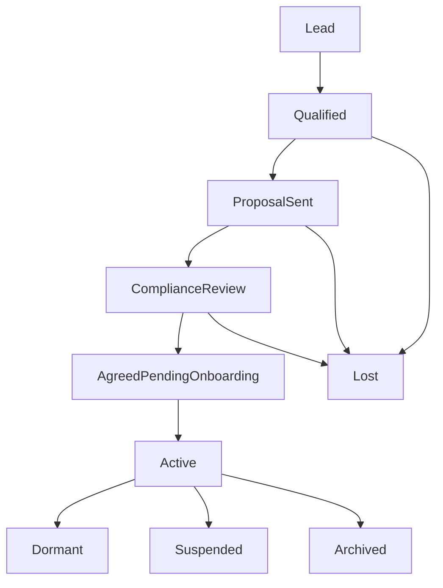
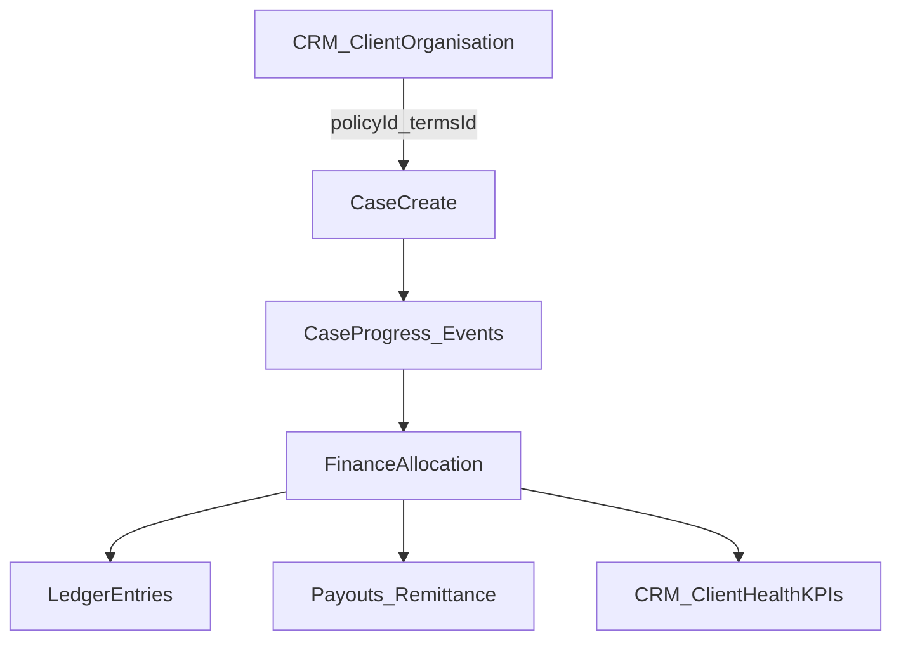

# CRM, Sales & Client Management Module (Spec)

This document defines a **CRM/Sales/Client Management** module for EnforceSense to manage clients end-to-end: **lead → onboarding → case uploads → operations → invoicing/payouts → retention**.

**Notes**
- This is a **product spec + suggested EnforceSense mappings** (not an implementation commit).
- This section is designed so Sales/Account Management workflows do not clutter Collections/Ops screens while keeping shared client configuration and service delivery data accessible where needed.

## X.1 Purpose

EnforceSense must include a built-in CRM/Sales capability for managing clients end-to-end: lead → onboarding → case uploads → enforcement operations → invoicing/payouts → retention. This module becomes the system of record for client configuration, contacts, portal enablement, and commercial terms.

## X.2 Scope

### Included
- Client records (prospects + active clients)
- Contact management
- Notes, tasks, activities (calls/meetings/emails)
- Opportunity / pipeline tracking (optional but supported)
- Client onboarding checklist & approvals
- Client portal enablement + upload/report permissions
- Integration points to Case Management and Finance
- Role-based UI tabs and permissions (internal and client portal)

### Excluded (initial)
- Full marketing automation (campaigns, sequences)
- Full CPQ quoting engine (initial “proposal doc upload” is sufficient)

## EnforceSense entity mapping (recommended)

This is the recommended mapping so the CRM module fits the existing domain model (Client/Debtor/Case/Ledger):

- **ClientOrganisation** → EnforceSense **Client** (creditor / instructing party).
  - **Important**: A **Client** is not a Debtor. The Client is the creditor; the Debtor is the liable party.
- **Debtor (person/company)** remains in the Debtor module; CRM can *reference* debtor enrichment patterns but should not turn debtors into “sales leads”.
- **Case** links to Client and Debtor:
  - `Case.clientId` (who instructed the case)
  - `Case.debtorId` (who owes)
- **Ledger**: all money movement and allocations post to the ledger, with allocation rules driven by client commercial terms.

Recommended cross-links:
- CRM → Case: `clientId`, `policyId`, `termsId`
- Case → Finance/Ledger: event-driven allocation using `termsId` + statutory schedule
- Finance → CRM: client health KPIs for account management (read-only for most roles)

## CCS Quote Tool v2 — strong reference (read-only)

CCS Quote Tool v2 is a separate CRM system that already implements valuable patterns that EnforceSense should **reference** (especially for company research/enrichment and AI-assisted note improvement).

**Hard rule**
- You may **reference/read** CCS Quote Tool v2, but you must **NOT change** its code or prompts.

**Where to find it**
- Local (Windows): `C:\Users\david\Documents\CCS quote tool\CCS Quote Tool v2`
- GitHub (reference only): `https://github.com/dje115/ccs-quote-tool-v2`

**What to reuse conceptually (in EnforceSense)**
- Company research/enrichment patterns (e.g., Companies House checks, corporate status signals)
- AI cleanup/summarization of call notes and meeting notes
- Guardrails: audit logs, provenance, role visibility

## X.3 Data model

### X.3.1 Core entities

#### ClientOrganisation
- `client_id` (UUID)
- `tenant_id`
- `status` (Lead | Qualified | ProposalSent | ComplianceReview | AgreedPendingOnboarding | Active | Dormant | Lost | Suspended | Archived)
- `legal_name`, `trading_name`
- `company_number` (optional)
- `registered_address` (optional)
- `billing_address` (optional)
- `sector` (LA | Utility | Commercial | Landlord | Other)
- `primary_account_manager_user_id`
- `risk_rating` (Low | Med | High) (internal)
- `portal_enabled` (bool)
- `portal_branding_profile_id` (optional)
- `created_at`, `updated_at`

#### ClientContact
- `contact_id` (UUID)
- `client_id`
- `name`, `role_title`, `department`
- `email`, `phone`, `mobile`
- `preferred_contact_method` (Email | Phone | SMS)
- `is_primary` (bool)
- `consent_flags` (GDPR preferences; per tenant policy)
- `notes` (optional)
- `created_at`, `updated_at`

#### CRMActivity
- `activity_id`
- `client_id` and optional `contact_id`
- `type` (Call | Meeting | Email | Task | FollowUp)
- `subject`, `description`
- `owner_user_id`
- `due_at` (for Task/FollowUp)
- `completed_at`
- `outcome` (enum + free text)
- `attachments` (document links)
- `audit_log_id` (immutable record pointer)

#### CRMNote (append-only)
- `note_id`
- `client_id` and optional `contact_id`
- `created_by_user_id`
- `note_text`
- `visibility` (InternalOnly | RestrictedRole)
- `created_at`

**Append-only rule**
- Edits create a new version; the original is retained.

#### Opportunity (optional; supported)
- `opportunity_id`
- `client_id`
- `name`
- `pipeline_stage` (Lead | Qualified | ProposalSent | Negotiation | Won | Lost)
- `estimated_monthly_volume` (optional)
- `estimated_value` (optional)
- `probability` (0–100)
- `expected_close_date` (optional)
- `owner_user_id`
- `created_at`, `updated_at`

### X.3.2 Client configuration entities (versioned & auditable)

#### ClientCommercialTerms (versioned)
- `terms_id`
- `client_id`
- `pricing_model` (StatutoryFees | CommissionPercent | FixedPerCase | Hybrid)
- `commission_percent` (optional)
- `fixed_fee_amount` (optional)
- `chargeable_addons` (e.g., tracing fee, letter fee)
- `vat_rules` (tenant-defined; per service line)
- `effective_from`, `effective_to`

**EnforceSense mapping**
- Terms drive **Ledger allocation** rules:
  - Fee event → ledger entries (statutory fees, contractual commission, VAT, client payable)
  - Visibility rules: most roles see summaries only; Finance sees full breakdowns.

#### ClientPortalPolicy (versioned)
- `policy_id`
- `client_id`
- `portal_enabled` (bool)
- `allowed_upload_case_types` (list)
- `allowed_upload_channels` (UI | CSV | API)
- `allowed_document_types` (list)
- `case_visibility_rules` (e.g., only their cases; only certain statuses)
- `financial_visibility_rules` (statements/invoices allowed Y/N)
- `report_access_rules` (which reports)
- `notification_settings` (email recipients + triggers)

**EnforceSense mapping**
- Policy governs Case upload routes and what a client portal user can see for **Case** and **Case documents**.

#### ClientOnboardingChecklist
- `checklist_id`
- `client_id`
- `items[]` each with:
  - `item_type` (ContractSigned | DPA | BankDetailsVerified | PricingApproved | PortalEnabled | TrainingDone | FirstUploadComplete | etc.)
  - `status` (Pending | Completed | Waived)
  - `completed_by`, `completed_at`, `evidence_doc_id`

## X.4 Sales pipeline & status rules

### X.4.1 Client status transitions

Allowed transitions must be enforced:
- Lead → Qualified → ProposalSent → ComplianceReview → AgreedPendingOnboarding → Active
- Active → Dormant / Suspended / Archived
- Any → Lost (with reason), except Active unless admin approval

### X.4.2 Opportunity stages (if used)
Lead → Qualified → ProposalSent → Negotiation → Won/Lost

When Opportunity = Won, the system may suggest or auto-create onboarding checklist.

## X.5 UI / navigation requirements

### Core principle: role-context navigation

The product should support **role-context navigation**:
- **CRM/Sales context**: focuses on leads, opportunities, sales notes, tasks.
- **Operations/Collections context**: focuses on cases, debtors, notices, enforcement events.

**Shared data** (client configuration, contacts, portal policy, commercial terms) must be accessible from Operations context, but **Sales-only data** (sales pipeline, proposal negotiation notes, lead scoring) should be hidden by default from Operations users.

### Proposed left-side menu (internal) — context switcher model

At top-level: a **Context Switcher** (tabs or dropdown):
- `Operations`
- `CRM` (role-gated)
- `Finance` (role-gated)
- `Compliance` (role-gated)

#### CRM context — suggested side menu (SALES / ACCOUNT_MGR)
- Dashboard
- Leads
- Clients
- Opportunities
- Activities & Tasks
- Proposals & Documents
- Onboarding
- Reports (CRM)

#### Operations context — suggested side menu (CASE_ADMIN / AGENT)
- Dashboard
- Cases
- Debtors
- Scheduling / Routing
- Notices & Documents
- Uploads (client uploads + admin imports)
- Reports (Ops)

#### Finance context — suggested side menu (FINANCE)
- Dashboard
- Allocation & Ledger
- Statements & Remittances
- Payout Runs
- Invoices
- Reconciliation

#### Compliance context — suggested side menu (COMPLIANCE)
- Dashboard
- Client Compliance (DPA/contract status)
- Complaints
- Risk & QA
- Policy Audit Logs

### Client record tab layout (internal)

Client record is the central hub linking:
- CRM notes/activities/opportunities
- Client portal setup
- Client commercial terms
- Cases + uploads
- Finance (statements, payouts, invoicing)

Tabs (role/feature controlled):
- Overview
- Sales
- Contacts
- Activities
- Notes
- Onboarding
- Portal
- Cases
- Commercial Terms
- Finance
- Compliance
- Documents

## X.6 Client portal enablement (functional requirements)

Portal access is enabled per client from the Client record.

Portal users belong to a client and have client-roles:
- Client Admin / Client Ops / Client Finance / Client Read-only

Portal allows:
- Upload cases (UI + CSV; API optional later)
- Upload documents to cases
- View case progress (limited fields)
- Download reports (allowed list)
- View invoices/statements if permitted

Portal must never show internal-only data (agent notes, restricted statuses, internal fees unless allowed).

## X.7 Integration points

### X.7.1 CRM → Case management

When a case is created (manual by staff or uploaded via portal), the case must inherit:
- `client_id`, `client_policy_id`
- Allowed workflows / enforcement routes (per policy)
- Default templates (letters, notices) (per tenant)
- Pricing rules reference (`terms_id`)

### X.7.2 Case management → Finance/Ledger

On payment events and stage changes, allocation must use:
- `terms_id` (commercial terms)
- Fee schedule rules (statutory + contractual)
- VAT rules
- Client remittance configuration

### X.7.3 Finance → CRM (client health)

Finance summaries visible to internal account managers:
- Monthly volume, recovery %, disputes, average time-to-collect
- Outstanding invoices (client side)
- Payout cadence performance

## X.8 Audit, compliance, security

All CRM notes/activities/config changes must be auditable (who/when/what).

Commercial terms & portal policies must be versioned and immutable once superseded.

Role-based access control must support:
- Module access
- Tab access
- Field-level masking (finance/compliance fields)
- Client portal segregation (no cross-client access)

## Permission matrix (summary)

Legend: ✅ Full / 👁 Read / ❌ None / 🔒 Restricted fields

| Area | SALES | ACCOUNT_MGR | CASE_ADMIN | ENFORCEMENT_AGENT | FINANCE | COMPLIANCE | SYS_ADMIN |
|---|---:|---:|---:|---:|---:|---:|---:|
| Clients (basic) | ✅ | ✅ | ✅ | 👁 | 👁 | 👁 | ✅ |
| Sales/Opportunities | ✅ | ✅ | ❌ | ❌ | ❌ | ❌ | ✅ |
| Contacts | ✅ | ✅ | ✅ | 👁 | 👁 | 👁 | ✅ |
| Activities/Tasks | ✅ | ✅ | ✅ | 👁 | ❌ | ❌ | ✅ |
| Notes | ✅ | ✅ | ✅ | 👁 | ❌ | ✅ | ✅ |
| Onboarding | 👁 | ✅ | ✅ | ❌ | 👁 | ✅ | ✅ |
| Portal Settings | ❌ | 👁 | ✅ | ❌ | ❌ | 👁 | ✅ |
| Cases | 👁 | ✅ | ✅ | ✅ | 👁 | 👁 | ✅ |
| Commercial Terms | ❌ | 👁 | ❌ | ❌ | ✅ | 👁 | ✅ |
| Finance | ❌ | 👁🔒 | ❌ | ❌ | ✅ | 👁🔒 | ✅ |
| Compliance | ❌ | 👁🔒 | 👁 | ❌ | ❌ | ✅ | ✅ |
| Documents | ✅ | ✅ | ✅ | 👁 | 👁 | 👁 | ✅ |

## AI assist in Sales (must-have opportunities)

EnforceSense should use AI to assist where it improves speed and quality, with auditability and role-visibility controls:

- **Company enrichment** (strong CCS Quote Tool v2 reference)
  - Suggest: company number, registered address, trading status, directors, insolvency signals
  - Output: structured “Research Summary” + sources
- **Notes cleanup & summarization** (strong CCS Quote Tool v2 reference)
  - Clean operator notes into a consistent format
  - Generate call summaries + next actions
  - Keep originals; write AI summaries as separate entries with provenance
- **Next best action**
  - Suggest follow-ups, onboarding blockers, missing documents, stale opportunities
- **Proposal/onboarding drafting**
  - Draft checklists, proposal outlines, and client configuration suggestions

**Guardrails**
- AI outputs are suggestions, not facts; require user review before “finalize”.
- Record provenance: model, prompt template version, input sources, timestamps.
- Never leak internal-only data into client-facing exports or portal views.

## Data flows (reference)

### Flow A — Sales to active client

### Flow B — CRM → Case → Finance/Ledger

