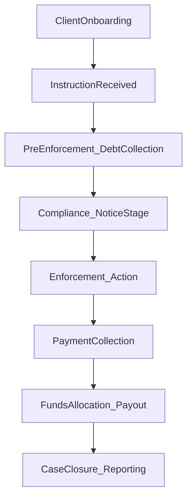
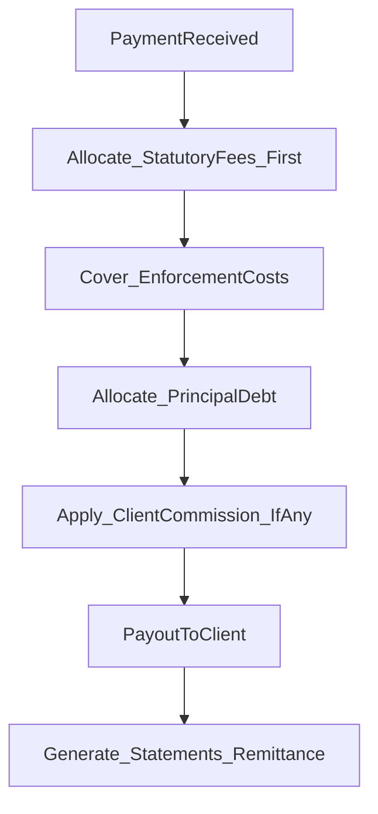

# UK Debt Collection & Enforcement (Bailiff) — End-to-End Operating Process

This document is a **generic, operational** end-to-end process map for a UK debt collection & enforcement company. It is intended to help agents and builders understand the standard lifecycle, responsibilities, and decision points.

**Notes**
- This is **not legal advice**. Always defer to qualified compliance/legal guidance and client-specific contracts.
- Terminology varies by business; the stages below reflect common UK operating patterns (including TCE 2013-style workflows).

## 1) High-level end-to-end lifecycle

**Lifecycle summary**
- **Client onboarding**: Contracting, pricing, compliance setup.
- **Instruction received**: Create case, validate route and enforceability.
- **Pre-enforcement / collections**: Contact, negotiate, trace, enrich data.
- **Compliance & notice**: Statutory/regulatory notices and waiting periods.
- **Enforcement**: Attendance and control of goods processes where applicable.
- **Payment collection**: Receive payments via controlled channels.
- **Funds allocation & payout**: Apply statutory fees/costs/principal/commission; remit to client.
- **Closure & reporting**: Audit trail, outcomes, complaints handling.

## 2) Departments & responsibilities (who does what)

| Department | Responsibility |
|---|---|
| Sales / Client Services | Onboard creditors, contracts, pricing, reporting preferences |
| Compliance & Legal | Regulatory adherence (e.g., notices, vulnerability policy), legal route selection |
| Case Admin / Ops | Case setup, document ingestion, tracing requests, scheduling |
| Debt Collection Team | Pre-enforcement contact, negotiation, payment plans |
| Enforcement Agents | Attendance, control of goods, evidence capture (e.g., body-worn video) |
| Finance | Client accounting, receipts allocation, fee splits, payouts, statements |
| Data / IT | Systems, integrations, audit logs, retention, access controls |
| Complaints & QA | Complaints, escalations, audits, quality reviews |

## 3) Client onboarding (creditor side)

### 3.1 Client acquisition
Common creditor types:
- Local authority
- Utilities
- Commercial creditors
- Landlords
- Private businesses
- Courts / tribunals / other instruction sources

### 3.2 Due diligence (KYC / KYB)
Typical checks and outputs:
- **Company verification** (e.g., Companies House / corporate checks)
- **Authority to instruct** (signatories, POAs, instruction rights)
- **Data Processing Agreement** (GDPR, controller/processor clarity)
- **Fee schedule agreed** (fixed / % recovery / statutory pass-through)
- **Indemnities / terms signed**

Outputs:
- Client record created
- Pricing rules recorded
- Payment split rules recorded
- Reporting preferences recorded
- Bank details validated (payout destination)

### 3.3 Contract & setup
Operational readiness includes:
- Instruction methods agreed (portal/API/email/SFTP)
- Document standards (required evidence, formats)
- SLA targets (contact attempts, reporting cadence)
- Escalation routes and client contacts

## 4) Instruction intake (case creation)

### 4.1 Instruction received
An instruction typically includes:
- Debtor details (often incomplete)
- Amount owed (principal + any pre-existing costs/interest)
- Debt type and context
- Court reference (if applicable)
- Supporting documents (judgment, contract, invoices, notices)

Debtor can be:
- Individual consumer
- Sole trader
- Limited company
- Partnership
- Multiple debtors for one obligation (joint and several complexities)

### 4.2 Case validation
Validation questions:
- Is the debt **enforceable** and within limitation?
- Is the **route** correct (collections vs enforcement vs insolvency)?
- Are there restrictions (e.g., vulnerability policy, moratorium, insolvency)?
- Is required paperwork present and consistent?

### 4.3 Case creation outputs
- Unique case ID
- Link to client
- Link to debtor entity (person/company)
- Initial status set (e.g., “New / Intake Review”)
- Evidence/documents stored with audit metadata

## 5) Pre-enforcement / debt collection stage

This applies to both personal and company debt, but conduct rules and options differ.

### 5.1 Tracing & data enrichment
Typical activities:
- Address verification (current/previous)
- Trading status checks (for businesses)
- Insolvency checks
- Deceased checks (consumer)
- Vulnerability indicators (consumer)
- Identity matching (reduce misidentification risk)

### 5.2 Contact attempts
Channels commonly used:
- Letters
- SMS / email (where permitted)
- Phone calls
- Online payment portal / self-serve

### 5.3 Negotiation
Typical outcomes:
- Payment in full
- Instalment plan
- Temporary hold / breathing space where applicable
- Dispute raised → compliance/legal review

### 5.4 Stage outcomes
- Paid → proceed to finance allocation/payout
- Plan agreed → monitor and manage arrears
- No response → escalate to compliance/notice stage
- Dispute → pause/escalate for review

## 6) Compliance & notice stage (critical)

### 6.1 Notices
Depends on route and debt type; examples include:
- Notice of Enforcement (where applicable)
- Letter Before Action / pre-action notices
- Statutory Demand (company debt route)
- Compliance stage notice (TCE 2013 workflows)

### 6.2 Mandatory waiting periods
Commonly:
- 7 clear days (with exclusions such as Sundays/bank holidays depending on rule set)

### 6.3 Vulnerability checks (consumer-focused)
Operationally, a vulnerability policy typically considers:
- Illness/disability
- Mental health
- Elderly
- Single-parent / caring responsibilities
- Financial hardship signals

If vulnerable → case may be paused, re-routed, or adjusted with enhanced safeguards.

## 7) Enforcement stage (bailiff action)

### 7.1 Attendance
Typical attendance workflow:
- Agent attends premises
- Identity and premises validated
- Purpose explained; notices/authority documented
- Evidence capture (e.g., body-worn video) enabled where policy requires

### 7.2 Enforcement options (high-level)
**Personal debts (consumer)** — commonly:
- Control of Goods Agreement (CGA)
- Clamping/vehicle control where permitted
- Removal of goods in permitted circumstances
- Forced entry generally limited to specific scenarios/routes

**Company debts (commercial)** — commonly:
- Entry to commercial premises (subject to route and authority)
- Taking control of business assets (stock, machinery, vehicles)
- Forced entry more likely to be available depending on enforcement authority
- Insolvency escalation may be a common parallel track

### 7.3 Enforcement outcomes
- Payment in full
- Part payment
- CGA signed / controlled goods listed
- No goods / gone away / business closed
- Enforcement fails → alternative route or closure/write-off

## 8) Payment collection & handling

### 8.1 Payment channels
Common channels:
- Card payments
- Bank transfer
- Cash (strict controls and reconciliation)
- Online portal
- Instalments

### 8.2 Trust & client accounts
Operational principles:
- Funds handled according to agreed client accounting model
- Clear separation where required (no commingling policies as applicable)
- Full audit trail: who took payment, channel, timestamps, references

## 9) Money flow — fees, splits & payouts

### 9.1 Example fee structure (simplified)
| Stage | Who pays | Typical |
|---|---|---|
| Compliance stage | Debtor | £75 |
| Enforcement stage | Debtor | £235 + % |
| Sale stage | Debtor | £110 + % |
| Commission | Client | % or fixed |

### 9.2 Allocation logic (generic)

Allocation principles (generic):
- Apply statutory fees and recoverable costs per route rules.
- Allocate to principal debt.
- Apply commission/fees per client contract.
- Determine net payable to client; generate remittance advice.

### 9.3 Client payout
Operational standards:
- Payout cadence (weekly/monthly) as contract-defined
- Statements and remittance advice issued
- VAT and invoicing handled per contract and tax treatment

## 10) Case closure & reporting

### 10.1 Closure reasons
Common reasons:
- Paid in full
- Unenforceable / cannot locate / insufficient evidence
- Insolvency (individual or corporate)
- Client recall
- Write-off instructed

### 10.2 Final reporting pack
Typical end-of-case outputs:
- Full audit log summary
- Payments ledger summary
- Actions taken (contacts, notices, visits)
- Evidence references (documents, bodycam refs where applicable)
- Compliance confirmation notes

## 11) Personal vs company debt — key differences

### 11.1 Legal/conduct differences (high-level)
| Area | Personal debt | Company debt |
|---|---|---|
| Conduct regime | Often more consumer-protective | Generally different expectations |
| Vulnerability rules | Often mandatory policy controls | Usually not applicable in same way |
| Forced entry | Very limited | More likely depending on authority |
| Statutory demands | Not typical | Common insolvency lever |
| Insolvency route | Possible but different dynamics | Common escalation path |
| Director liability | Rare | Sometimes relevant depending on facts/guarantees |

### 11.2 Process flow differences (simplified)
**Personal debt**
Instruction → Compliance checks → Notice(s) → Vulnerability review → Attendance (limited powers) → Payment/CGA → Allocation → Close

**Company debt**
Instruction → Trading status check → Notice(s) / statutory demand / enforcement route → Commercial attendance → Asset control/removal → Insolvency escalation (if required) → Allocation → Close

## 12) Where AI & automation fit (platform opportunities)

See also: **[CRM, Sales & Client Management Module (Spec)](CRM_SALES_CLIENT_MANAGEMENT.md)** for sales/onboarding AI assist patterns and role-based CRM vs Ops separation.

AI/automation can improve speed, consistency, and auditability in:
- Instruction validation (route selection checks, missing evidence detection)
- Entity matching (person vs company; reduce duplicate debtor creation)
- Tracing/enrichment orchestration (providers, Companies House, insolvency)
- Drafting standardized comms (letters/SMS/email templates with guardrails)
- Payment plan monitoring (risk of default; reminders)
- Fee calculation and allocation (rule-driven + explainable outputs)
- Complaint triage and QA sampling
- Reporting summaries (client dashboards; agent activity summaries)

